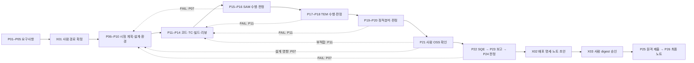

# IFPMIC AX 시각화와 이관 계획

> 현재 사용자 흐름별 전달 순서와 빠른 개발 검증은 [애자일 전달 계획](./AGILE-DELIVERY.md)을 따른다. 아래 원본 범위와 최종 AT·보안·승인 게이트는 그대로 유지한다. 중간 mock/부분 결과를 최종 인수로 계산하지 않는다.

현재 접수 흐름은 mock 상태 조회 → 실제 read API → 실제 엔진 접수로 나눠 전달했다. 다음 최소 모의 흐름도 합성 결과 조회 → 저장 결과의 실제 조회 → 제한된 실제 서비스 실행으로 나눈다. 사람 대기/재개와 첫 I2C 사례의 slice도 `delivery-plan.json`에 둔다. 설계와 구현은 사용자 행동 하나에 필요한 변경만 먼저 연결하며, 순수 계산/계약·저장/권한·실행 activity·화면 controller를 분리해 각 경계를 작은 검사로 개발한다.

기본 검사는 변경 경계에 맞게 선택하고 전달 도구·supervisor·browser·build를 모든 변경에 묶지 않는다. 원본 전체 H2/AT는 최종 수용에 남긴다. V9 timeout 진단은 30분 checkpoint의 별도 지원 작업이며 관련 crash/reclaim 및 전체 수용만 차단한다. 검토는 바뀐 경계와 영향 경로에 한정하고, 실제 DB/Temporal 연결 전 변경된 보안 경계는 독립 검토한다. 과거 후보의 승인과 증거는 후속 후보에 승계하지 않는다.

현재 AX의 기록 관제와 Paperclip 실험을 기반으로, IFPMIC 설계서의 업무 흐름을 Paperclip 기반 화면에서 확인하고 조작할 수 있게 한다. 최종 기준은 제공된 DOCX와 ZIP의 계약이다. 첫 산출물은 계약에 맞는 흐름 시각화이며, 다음 완료 단위는 B01–B05의 지속 실행 가능한 모의 완주다.

이 계획에서 구조와 단계 배치는 구현 방향이다. 실제 구현·검증 상태는 [진행 기록](./progress.json)과 단계별 증빙으로 확인한다. 화면 구현과 업무 실행 서비스의 완료를 구분한다.

## 현재 자료의 이관 범위

| 현재 자료 | 옮길 내용 | IFPMIC에서 달라지는 점 |
|---|---|---|
| `src/App.tsx`, `src/agent-filter.mjs` | 역할·상태 필터, 상세 선택, 키보드 이동, 조상 맥락과 반응형 화면 경험 | 세션 트리 외에 job의 단계 그래프와 cycle 이력을 추가 |
| `server/store.mjs`, `snapshot-store.mjs`, `claude-store.mjs`, `opencode-store.mjs` | 공급자별 기록 정규화, 프로젝트 제한, 안전한 표시 텍스트 | 과거 기록 조회용으로 유지. 실행 adapter는 신규 계약으로 분리 |
| `experiments/paperclip/ax-workflow.json`, `FLOW.md` | 명시적 담당·전이·검증 구조 | 4팀·11단계는 과거 AX 개발 사례로 보존하고 IFPMIC 6역할·29노드를 신규 등록 |
| `ax-controller.mjs`, `ax-stage-agent.mjs` | checkpoint, 정의 고정, 독립 검증, 복구·reconciliation 경험 | 로컬 파일 잠금을 다중 사용자 DB/Temporal 제어로 확장 |
| `experiments/paperclip/runs/` | 과거 실행의 출처와 증거 | 과거 AX 수락을 IFPMIC 수락이나 새 후보 증거로 승계하지 않음 |

기존 AX의 세션은 `legacySessionRef` 같은 출처 참조로 연결할 수 있다. 사용자가 매핑한 기록만 job에 연결하고, 근거가 없는 step 완료·부모 관계·배포 승인을 만들어내지 않는다. 인증 자료와 원시 기록 전체를 새 DB에 복사하지 않는다.

## 화면에서 표현할 업무 구조

역할은 `spec-gen`, `tc`, `code-dev`, `arch-runner`, `sqe`, `report`의 6개다. `human`과 `system`은 별도 담당 유형이다. code-dev의 tc 호출은 서버가 예약·기록하며, TC는 분리 worktree에서 패치를 전달한다.

| JSON phase | 표시 이름 제안 | 노드 |
|---|---|---|
| 1 | 기획과 분석 | P01–P04 |
| 2 | 요구사항과 시험 계획 | P05, X01, P06 |
| 3 | 설계 | P07–P09 |
| 4 | 개발 | P10–P14 |
| 5 | 품질관리 | P15–P21 |
| 6 | 검증과 배포 | P22–P24, X02, X03, P25, P26 |

phase 번호와 노드 소속은 `workflow.v1.json`을 따른다. 표시 이름은 UI 메타데이터 제안이다. DOCX의 장 구분에서는 P05/P06도 기획·분석 절에 있으므로, 장 제목을 JSON phase와 동일한 것으로 가정하지 않는다.

다음은 계약의 주요 구간과 업무 실패 복귀를 압축한 도식이다. 실제 화면은 각 P/X 노드를 펼치며, 상세 전이는 JSON의 `on_pass`, `on_business_fail`, `special_outcomes`에서 생성한다.

P13/P14 실패는 P11, X01 반려는 P02, X03 반려는 사유에 따라 P11/P07/X02로 연결한다. P23의 ‘배포’는 작업 안의 검증 보고서 공개다. P25의 원격 제출과 구분한다.

사람 증거가 필요한 노드는 X01, P06, P07, P08, P10, P21, X03이다. SAM/SQE 실패로 P07에 복귀하면 사람이 설계를 재검토해야 한다. 완료 에이전트 응답으로 이 단계를 자동 통과시키지 않는다.

## 시각화 요구사항

| 화면 | 핵심 표시와 동작 |
|---|---|
| 내 작업 목록 | 제목, 변경 유형, 현재 단계, 대기 사유, 마지막 사건, 결과와 mock/real |
| 요청 등록 | BUGFIX/FEATURE/NEW_HW, 저장소·기준 ref, 요구사항, 첨부, 단말, 제출 모드 |
| 실행 상세 | 상단 job/cycle/후보, 왼쪽 6 phase와 단계 흐름, 오른쪽 선택 단계의 담당·입출력·조건·증거, 하단 timeline |
| 내 작업함 | 사람 문서·질문·경로 확인·수동 결과·반복 한도 처리와 알림 |
| 배포 확인 | 후보 commit·이미지·품질 결과·대상·버전·노트 초안·digest와 승인/반려 |
| 장비 연결 | PC/단말 식별, 연결 모드, heartbeat, 점유 job, 불명확 상태와 수동 전환 |

에이전트 실행 상태, 업무 단계 상태, PC/단말 연결 상태를 각각 표시한다. `WAITING_AGENT`에는 자식 execution을, `WAITING_HUMAN`에는 해야 할 사람 작업을, `WAITING_DEVICE`에는 실제 대기 이유를 연결한다. `RECONCILING`은 실패나 재시도 가능으로 단순화하지 않는다.

성공 경로, 실패 복귀 경로, 선택한 cycle/attempt, 생략된 노드와 근거를 함께 볼 수 있어야 한다. 색 외에도 상태 이름과 아이콘을 제공하고, 키보드 선택·상세 이동과 좁은 화면을 지원한다. 진행률은 ‘적용 단계 중 완료 단계 수’로 표시하고 근거 없는 ETA나 정밀 퍼센트를 만들지 않는다.

진행 이벤트는 관측 가능한 도구 작업 종류·상태, 산출물 참조와 짧은 요약만 전달한다. 추론, 원시 명령, 도구 입력/출력, 인증 자료는 API에서 제외하며 표시 텍스트는 `safeText`를 거친다. 상세 증거는 권한을 확인한 정제 artifact로 제공한다.

## Paperclip과 업무 실행 계층의 경계

채택 방향은 Paperclip 기반 별도 IFPMIC 화면과 설계서의 FastAPI·Temporal 서비스 조합이다. 초기에는 별도 checkout과 DB에서 Paperclip을 고정 버전으로 실행한다. 기존 AX localhost 읽기 전용 서버에 쓰기·장비 제어 API를 추가하지 않는다.

| 계층 | 책임 |
|---|---|
| Paperclip 기반 UI | 조직·작업 탐색, IFPMIC workflow 화면, 실행·증거 링크 |
| IFPMIC API | 인증, 프로젝트/job 권한, schema, artifact, command 수락과 outbox, SSE |
| Temporal | 단계 전이의 단일 결정자, 사람 대기, 타이머, cycle, version pin과 재개 |
| PostgreSQL | 명령·outbox, 불변 증거 메타데이터, 조회 projection 및 Paperclip 매핑 |
| Workers와 adapters | 역할별 실행, 빌드·측정 wrapper, 공통 TaskResult와 이벤트 |
| Windows bridge | outbound HTTPS, SQLite journal, 명시적 단말 식별·lease·fencing |
| Publisher | digest 승인 재검사, 제한된 제출 자격증명, 원격 결과 조회와 receipt |

Paperclip company/project/agent/issue/case/run과 IFPMIC project/job/role/step_run/execution 사이에 ID 매핑을 둔다. Company 경계만으로 개인 job 권한이 충족된다고 보지 않는다. 모든 상세 조회와 다운로드에서 IFPMIC 소유권·프로젝트 권한을 확인한다.

사용자의 IFPMIC 조작은 API 명령 → outbox → Temporal → projection/event 순서로 처리한다. Paperclip 화면의 별도 상태 변경으로 IFPMIC gate를 해제하지 않는다. 해당 case의 독립 routine·자동 전이는 끄고, 실행 계층의 결과를 멱등 반영한다. Paperclip을 실행기 호출에 사용하면 그 경로만 사용하고 같은 task를 worker가 직접 중복 호출하지 않는다.

첫 연결 검증에서는 UI 확장 경로, API 권한 전달, pipeline projection, 실행 ID와 사용량 귀속을 확인한다. Paperclip 관리 화면의 직접 조작도 authoritative 상태를 바꾸지 못하도록 차단한다. 기본 transcript/API가 IFPMIC에서 제외할 원시 데이터를 노출하지 않는지 점검한 뒤 실사용 화면에 연결한다.

## 상태와 증거의 불변 조건

- `agent completed`, step `SUCCEEDED`, gate `PASS`는 별개다. 판정은 wrapper/parser와 버전이 고정된 사내 기준으로 한다. 결과 누락은 ERROR/INCONCLUSIVE다.
- 생략은 근거·baseline hash·승인자·plan_version을 가진 `SKIPPED`다. 측정과 판정은 함께 면제하며 EXEMPT를 PASS로 바꾸지 않는다.
- job/step/cycle/attempt/execution을 연결한다. 과거 attempt를 덮어쓰지 않고, 오래된 결과는 현 cycle의 gate를 해제하지 못한다.
- 코드·TC·설정·도구 또는 규칙 변경에 따른 증거 무효화와 후보 fingerprint를 기록한다. mock 증거로 real 배포를 승인하지 못한다.
- HTTP 202는 명령 접수다. UI는 applied/rejected를 확인하고 `expected_revision`, Idempotency-Key를 사용한다. SSE는 Last-Event-ID를 재생하고 cursor 만료 410이면 snapshot을 다시 읽는다.
- 한 workspace에는 한 쓰기 실행, 한 단말에는 한 활성 작업만 허용한다. lease 만료 때 실행이 불명확하면 격리하고 재할당하지 않는다.
- 플래싱과 원격 제출 응답 유실은 실제 결과 조회 후 재개한다. P25 성공 후 P26 실패는 `RELEASED_PENDING_NOTES`로 두고 노트만 재시도한다.

## 구현 순서와 완료 기준

V 단계는 중간 사용자 흐름 전달이며 원본 B 백로그를 대체하지 않는다. 개발 단계에서는 검토 가능한 국소 구현·mock 경로를 좁은 회귀로 전달할 수 있다. 변경 source·환경·계약·권한·격리·cleanup이 준비된 뒤 좁은 실제 DB/Temporal 통합 검사도 full490 전에 수행할 수 있다. 전체 490건 H2는 전체 수용 및 운영 활성화 단계에서 유지한다. 중간 mock/통합 결과를 전체 acceptance로 주장하지 않는다.

| 순서 | 산출물 | 완료 확인 |
|---|---|---|
| V0 자료 기준 고정 | Paperclip 조사, 원본 계약·해시 보존, 이관 계획 | 이번 문서 변경 범위. 계약 구조 53/53, AT는 미실행 |
| V1 계약 기반 정적 시각화 | 별도 IFPMIC 화면에서 29노드·6 phase·담당·정상/실패/반려 edge와 상세 panel | JSON과 노드/edge 비교, 사람·system 구분, 키보드·좁은 화면 확인 |
| V2 모의 상태 탐색 | 성공, 사람 대기, TC 대기, 장비 단절, SAM/TEM/SQE 실패, 재작업·생략·불명확 결과 fixture | cycle/attempt 전환과 실제 근거 표시. ‘시나리오 재생’으로 표시하고 실행 서비스와 구분 |
| B01–B02 | 계약 validator, 불변 profile, 사용자 범위 API·DB·workspace | AT-04/28, AT-21 |
| B03–B05 | Temporal, outbox, 사람 작업, 웹/SSE, 실패 주입 mock adapter | 재시작 후 대기 복구, 모의 전체 완주. AT-05/16/29, AT-03/27, AT-01/09/10/11 |
| B06–B08 | Bedrock Claude Code, TC patch handoff, KUnit/build, SAM/TEM/정적분석·OSS | AT-06/23, AT-02/07/30, AT-08/12/31 |
| B09–B10 | Windows bridge, 식별 매핑, journal, 장비 점유, SQE와 수동 대체 | AT-14/22/32, AT-13/15 |
| B11–B12 | digest 승인, 4개 제출 경로, receipt, 복구·취소·백업 훈련 | AT-18/19/20/26, AT-17/24/25/27 |
| B13 | OpenCode 실행 adapter와 신규 HW SW 대응 경로 | AT-01/04/23 |

V1/V2는 UI 검토용 중간 전달이다. 설계서의 최종 순서는 B01–B05의 모의 완주, B06–B08의 실제 개발·품질, B09–B12의 단말·승인·제출이며 B13도 원본 백로그에 남는다. 중간 UI 완료율과 이 최종 범위의 수용률은 따로 보고한다. 기간은 사내 빌드와 연결 준비를 확인한 뒤 산정한다.

B04의 ‘4개 화면’은 목록·요청 등록·실행 상세·내 작업함을 우선 구현하는 것으로 계획한다. 원본에 4개 화면의 명칭은 없으므로 이 배치는 구현 제안이다. 배포 확인·장비 연결을 포함한 최종 6개 화면 요구는 유지한다.

## 첫 실증과 연동 준비

첫 실제 job은 IFPMIC I2C 레지스터 읽기 실패 처리 확인과 필요 시 수정, 정상/실패 경로 KUnit TC 보완이다. 함수의 errno나 수정 위치는 실제 저장소와 사양을 읽고 결정한다. 단말 부팅·기본 스크립트 통과를 I2C 오류 경로 재현 증거로 사용하지 않는다.

시각화·mock은 제공 계약으로 진행할 수 있다. 실제 실행 전에는 저장소·기준 ref·드라이버/TC 경로, 빌드/toolchain/config, 품질 도구·샘플·기준, Bedrock/runtime 버전, SSO, 단말/flash/boot/SQE profile, 제출 대상·권한·승인자를 준비한다. 설정 전에는 예제 profile의 비활성 mock 상태를 유지한다.

설계서가 참조하는 이전 원본 문서와 10월 9일 확정 대화는 이번 입력에 포함되지 않았다. 이 계획은 제공된 IFPMIC v1을 기준으로 하며 이전 원문을 별도로 검증했다고 표시하지 않는다. 독립 승인자 필수 여부는 profile 기본값 `require_distinct_approver=false`와 사내 정책을 실제 연동 시 확정한다.

## 검증 기록과 다음 작업

ZIP의 JSON 11개, 요구사항 15개, 수용사례 32개, 백로그 13개를 검토했다. 원본 검증 도구를 임시 복사본에서 실행한 결과 구조 검사 53/53이 통과했다. 이는 서비스·사내 도구·장비가 통과했다는 뜻이 아니다.

이번 문서 변경의 저장소 검증은 `npm test` 148/148 및 `npm run build` 통과다. 가져온 참조 파일 17개는 ZIP 원본과 바이트 및 SHA-256이 일치하며 문서 내부 로컬 링크도 확인했다.

V1은 별도 Paperclip 기반 화면에 원본 계약을 읽어 29개 노드와 모든 전이를 표시하고, 선택 노드의 담당·입출력·완료 조건·생략 정책을 확인하도록 구현한다. V1의 독립 검증과 실제 host 장착 증거를 확인한 뒤 V2에서 모의 이벤트를 표시하고 B01–B05의 지속 실행 계층에 연결한다.
