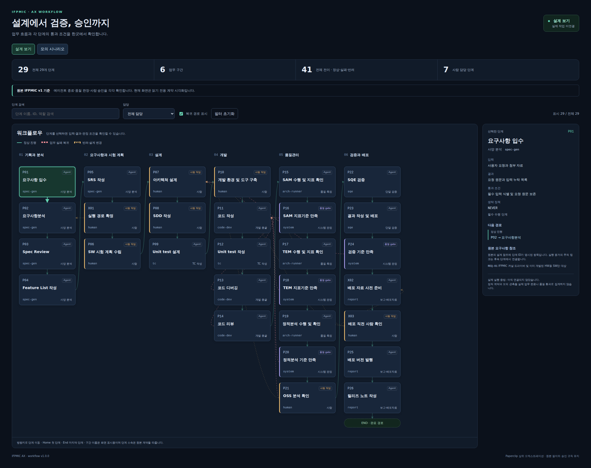

# 첫 번째 공개 결과 — workflow 탐색과 모의 재생

**열기: http://127.0.0.1:4173/ifpmic.html**

기존 구현을 현재 소스로 빌드하고 화면을 새로 검증해 공개했다. 이번 주기에는 제품 기능을 새로 추가하지 않았으며, 이미 있는 결과를 직접 검토할 수 있게 전달 방식과 개발 순서를 바꿨다.

1. `설계 보기`에서 단계를 누르면 담당·입력·결과·통과 조건·다음 경로를 확인할 수 있다.
2. `모의 시나리오`로 바꾸고 시나리오를 고른다.
3. `다음 관측` 또는 `끝 관측`으로 정상 진행, 사람 대기, 실패 복귀를 확인한다.
4. 담당 필터·검색으로 관심 구간을 좁힌다. 흐름 영역은 가로로 스크롤할 수 있다.

| 직접 확인한 항목 | 결과 |
|---|---|
| 현재 소스 build / TypeScript | 통과 |
| 설계 화면 browser 검사 | 8개 통과 /0 실패 |
| 모의 재생 browser 검사 | 19개 통과 /0 실패 |
| 로컬 주소의 실제 브라우저 관찰 | 29단계 /6구간 /41연결 /74합성 시나리오 |
| 로컬 캡처 중 페이지 오류 /외부 요청 | 0 /0 |
| 보호된 AX 원본과 설계 보존 | 96파일·89 inventory·설계17·업로드2 해시/목록 일치 |

[검증 요약](./verification.json) · [계획 검토](./plan-review.json) · [새 개발 계획](../../AGILE-DELIVERY.md)

## 현재 화면

[사람 대기 모의 화면](./human-wait-desktop.png) · [모바일 화면](./workflow-mobile.png)

이번 결과는 로컬 정적 설계와 합성 사건 재생이다. 실제 API 작업 생성·Agent 실행·장비·Paperclip 호스트 장착·배포를 이번 검증에서 완료 처리하지 않는다. 기존407개 runtime 테스트의 과거 통과와 현재490개 미실행 후보도 별도로 유지한다.

다음 공개 결과는 **실제 요청 한 건을 등록하고, 저장된 작업의 현재 단계와 대기 사유를 화면에서 조회하는 흐름**이다. 실제 연동을 시작하기 전에 해당 요구사항·소유권·중복/오류 처리·필수 게이트를 구체화한다.
