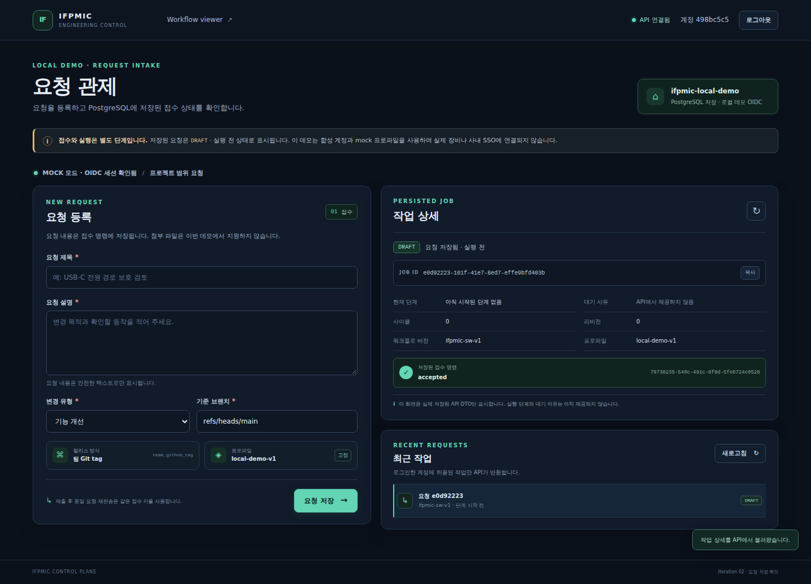

# 주기02 — 실제 요청 저장 화면

**화면: http://127.0.0.1:8769/** · `OIDC 로그인`에서 데모 사용자 A를 선택하면 저장된 작업을 조회하거나 새 요청을 등록할 수 있다.

이번 결과는 실제 IFPMIC HTTP API·OIDC callback/세션·PostgreSQL에 연결된 요청 등록 → 목록 → 상세 흐름이다. 계정 두 개와 프로파일은 합성 데모다. 실제 에이전트·장비·배포는 연결하지 않았다. 상태는 `DRAFT`(요청 저장됨 · 실행 전), 명령은 `accepted`, 현재 단계는 비어 있다. API가 아직 제공하지 않는 대기 사유는 화면에 그대로 표시한다.



## 확인한 결과

- 새 흐름 브라우저17건, 같은 데이터로 서버 재시작 후 조회2건 통과. 로그인·입력 오류·401/403·A/B 소유권·응답 유실 후 같은 키 재시도·중복 클릭·새로고침·HTML 입력·저장소 장애·모바일을 확인했다.
- 읽기 전용 SQL로 계정A/B의 논리 요청 각각 job/command/outbox/intent 한 건을 확인했다. 응답 유실 재시도가 중복을 만들지 않았다. 재시작 전후 관찰한8개 테이블의 모든 행이 같았다. 실행 binding/attempt/scope/receipt는0건이다.
- 정상 종료 시 API·PostgreSQL PID와 포트 종료, OIDC thread/socket 정리, 데이터 보존을 확인했다. 같은 이름으로 API·DB·issuer를 재시작해 화면을 다시 열었다.
- 기존 빌드와 설계8건·시나리오19건 회귀 통과. 보호된 AX96개 해시/89개 목록, 설계17개, 원본2개, Python 환경1777개 파일이 유지됐다.
- 첫 로그인·종료 실패와 수정 근거도 [실패 기록](./runtime-attempts.json)에 보존했다. 최종 증빙은 [검증 결과](./verification.json), [독립 소스 검토](./source-review.json), [독립 결과 검토](./result-review.json)를 따른다.

## 다시 실행

저장소 루트에서 이미 검증된 Python/Node/PostgreSQL 환경을 사용한다. 자동 설치·다운로드를 하지 않는다.

```sh
PYTHONDONTWRITEBYTECODE=1 .ifpmic-venv/bin/python -B experiments/ifpmic-live/launcher.py --name iteration-02
```

주소는 `http://127.0.0.1:8769/`다. 종료는 실행 터미널에서 Ctrl+C를 사용한다. 같은 `--name`은 같은 private DB를 유지한다. 데이터와 로그는 gitignored `workflow-artifacts/live-demo/iteration-02/`에 보관하며 원본 AX/Paperclip DB와 분리된다. 고정 mock eligibility의 유효기간은7일이며 만료 시 자동 갱신하지 않는다.

브라우저 검증은 별도 터미널에서 `node experiments/ifpmic-live/verify.browser.mjs`로 실행한다. 검증은 실제 데모 요청 두 건을 추가하므로 새 빈 검증용 `--name`의 서버에서 수행한다. 기존 사용자 요청을 삭제해 테스트 상태를 맞추지 않는다. `--persist-read`는 비공개 `persist-receipt.json` 경로를 `IFPMIC_I02_PERSIST_STATE`로 받아 기존 작업만 조회한다.

## 다음 하나

필수 H2 검증을 통과한 실제 실행 한 구간의 run/결과를 이 화면에 연결한다. 이번 저장 지속성은 AT16 outbox 재배달 검증을 대체하지 않는다. AT21 전체·AT32·H2 전체·최종 workflow 완료는 미수용이다. 전체16단계 중 완료2개(12.5%) 집계는 유지하며, 이 주기는 사용자에게 전달한 부분 기능으로 별도 추적한다.
